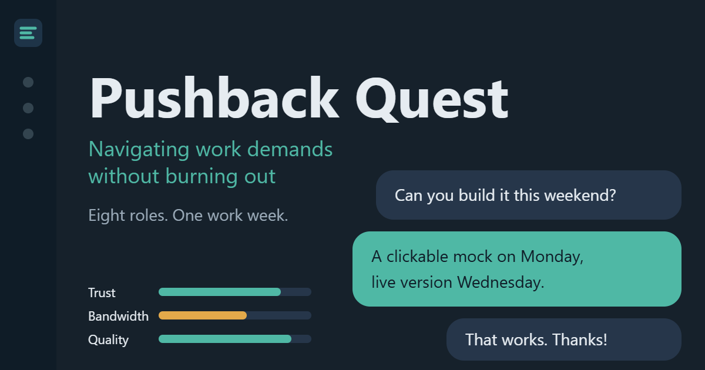
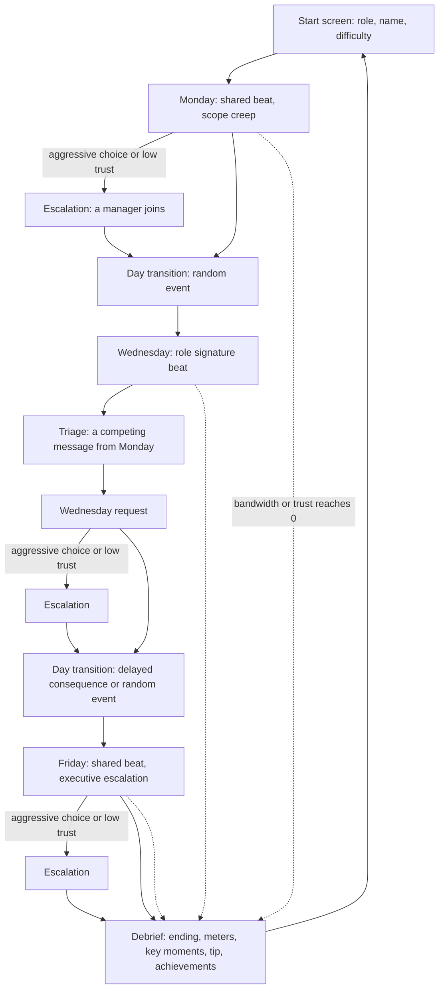
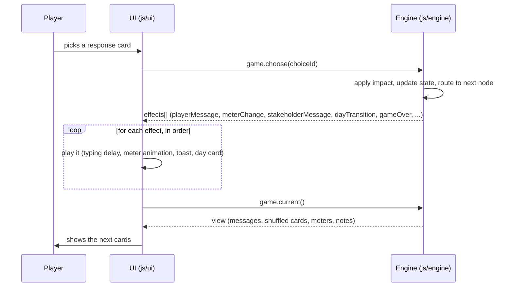

# Pushback Quest

*Navigating work demands without burning out.* A browser game where you practice saying no, negotiating trade-offs and holding boundaries across eight professional roles.

**[Play it](https://example.github.io/pushback-quest/)** (replace this placeholder with your GitHub Pages URL after the first deploy)



*Replace this image with a screenshot or GIF of a play session once the site is live.*

## What it is

You live through one high-pressure work week inside a fictional workplace chat app. You pick a role, receive realistic requests from managers, peers, clients and executives, and choose how to respond. Three meters (Trust, Bandwidth, Quality) react to every decision, and what you did on Monday comes back on Wednesday and Friday.

It is a portfolio piece for visitors who work in learning and development, engineering, recruiting or hiring. A first-time visitor can start in one click and finish in 5 to 8 minutes. The instructional design rationale lives in [docs/DESIGN.md](docs/DESIGN.md), not in the game.

### The four techniques it teaches

"Assertive Alignment" is this project's own label for a synthesis of established assertiveness and negotiation practice.

1. **Trade-off framing:** "I can do X. To keep the date, should we drop Y or move Z?"
2. **Clarify before committing:** ask questions that reveal real effort, dependencies and priorities.
3. **Impact-first language:** explain pushback as business risk, not personal inconvenience.
4. **Firm boundaries:** when a request breaks policy, security, safety or ethics, a respectful no with a reason and an alternative is the right answer. Compromise is not always correct.

## Features

- **Eight roles:** HR Business Partner, Software Engineer, Account Executive, Marketing Specialist, Operations Coordinator, Service Desk Analyst, Customer Support Specialist and Financial Analyst. Each has its own stakeholders, scenarios, insights, boundary moment and coaching.
- **Three meters** with role-specific meaning for Quality, and three difficulty levels (New joiner, Standard week, Crunch week).
- **Mechanics:**
  - a shared Monday and Friday beat and a role-specific Wednesday beat
  - cards shuffled with a seeded random generator
  - information as a resource: good questions earn notes that unlock the strongest Friday responses
  - escalation chains when a manager joins the thread
  - competing messages on Wednesday (triage)
  - random workplace events and delayed consequences for over-committing
  - non-negotiable boundary moments
  - ten achievements
  - six endings computed from game state, and a role-aware debrief
- **Accessible by design:** full keyboard play (number keys choose cards), WCAG 2.2 AA contrast checked by tests in light and dark themes, screen reader live regions, reduced motion support, 44px touch targets and reflow down to 320px.
- **Private by design:** no accounts, no backend, no analytics, no trackers, no cookies. Progress (achievements and settings) stays in your browser's local storage.
- **Original interface:** inspired by modern workplace chat apps but not copied from any of them. The fictional app is called Threadline.

## How it works

The week, from the player's side:



The engine and the interface are separate. The engine is pure logic with no DOM access, so the same code runs in the browser, in the unit tests and in the simulator. The engine returns an ordered list of *effects*; the interface plays them with typing delays and never changes game state.



More detail is in [docs/ARCHITECTURE.md](docs/ARCHITECTURE.md).

## Run locally

ES modules need a web server, so opening `index.html` from disk shows a message instead of the game. On Windows, double-click `play.cmd`. Otherwise, from the repository root, use either:

```bash
python3 -m http.server
```

```bash
node tools/serve.mjs
```

Then open the URL it prints (`http://localhost:8000/` for Python, `http://localhost:8080/` for the Node server). Add `?seed=12345` to the URL to replay a specific run; the seed is also shown at the bottom of every debrief ("Run #48213").

There are no dependencies to install. Node 20 or later is only needed for the tools and tests.

## Scripts

| Command | What it does |
|---|---|
| `npm test` | Runs the unit tests (`node --test`): engine, content, achievements, linter, simulator, accessibility and security guards. About a minute. |
| `npm run lint:content` | Validates every role file and the shared content against the schema, length limits, brand list and balance ranges. |
| `npm run simulate` | Enumerates every choice path for every role and difficulty and checks the balance targets. Use `-- --roles tech --seeds 1` for a quick run; all eight roles with 3 seeds take about ten minutes. |
| `npm start` | Serves the site locally on port 8080. |

## Project structure

```
index.html
assets/           favicon, logo, social preview image
css/              tokens, base, layout, components
js/
  main.js         bootstrap and routing
  storage.js      safe localStorage wrapper
  progress.js     saves finished runs
  engine/         pure game logic (no DOM)
  ui/             start screen, shell, thread, cards, meters, notes, debrief
content/          config, events, endings, achievements, strings, role cards
  roles/          one file per role
tools/            serve.mjs, lint-content.mjs, simulate.mjs
tests/            node:test unit tests
docs/             DESIGN.md, ARCHITECTURE.md, CONTENT-GUIDE.md
.github/workflows ci.yml, pages.yml
```

## Adding or editing a role

See [docs/CONTENT-GUIDE.md](docs/CONTENT-GUIDE.md). In short: copy an existing role file, keep the node ids and impact pattern, run `npm run lint:content` and `npm run simulate -- --roles <id>`, and add the start-screen card.

## Design rationale

[docs/DESIGN.md](docs/DESIGN.md) is a case study of the performance problem, the target behaviors, the instructional design choices and the limitations.

## Deploying

Pushing to `main` runs `.github/workflows/pages.yml`, which publishes the game to GitHub Pages. In the repository settings, set **Pages → Source** to **GitHub Actions** once. The site works from a project subpath such as `https://<username>.github.io/pushback-quest/` because every path is relative.

Before sharing the link, replace the placeholder URL `https://example.github.io/pushback-quest/` in `index.html` (the canonical link, `og:url`, `og:image` and `twitter:image`) and in this README.

## Deviations from the original brief

These are deliberate and documented so a reviewer is not surprised:

- **Assertive Bandwidth cost** is allowed to range from −10 to +5 (the brief said −5 to −10). With the original range, Master Negotiator could not be reached on Standard difficulty from a start of 75 Bandwidth. Trade-off and repair cards that remove or defer work can give a little capacity back. The range lives in `content/config.js`.
- **Crunch week** cannot reach Master Negotiator (it starts at 55 Bandwidth). The brief sets balance targets for Standard only.
- **One click starts a run:** picking a role card starts the week, so there is no separate "Start the week" button.
- **HR Wednesday:** the offer-letter request comes from the hiring manager's director rather than the same manager, so the Wednesday triage always involves two different people.
- **Pages deploys a staged copy** of the runtime files (`index.html`, `assets`, `css`, `js`, `content`) rather than the whole repository, so tests and tools are not published.

## Privacy and security

No third-party scripts, no analytics and no trackers. The only network request is the Google Fonts stylesheet and font files (Atkinson Hyperlegible and Bricolage Grotesque). A Content-Security-Policy is set in `index.html`, there are no inline scripts or handlers, and all dynamic text is inserted with `textContent`, never `innerHTML`. Tests enforce these rules.

## Portfolio listing

Copy this block into a "Gamified projects" section:

- **Title:** Pushback Quest
- **One-liner:** A workplace simulator where you practice saying no, negotiating trade-offs and holding boundaries across eight professional roles.
- **Tags:** Scenario-based learning, Game design, Vanilla JavaScript, Accessibility
- **Links:** [Play](https://example.github.io/pushback-quest/), [Design case study](docs/DESIGN.md), [Source code](https://github.com/example/pushback-quest)
- **Thumbnail:** `assets/og-image.png`

## Credits and license

- Fonts, loaded from Google Fonts: **Atkinson Hyperlegible** (Braille Institute) and **Bricolage Grotesque** (Mathieu Triay), both under the SIL Open Font License 1.1.
- All companies, products, clients and people in the game are fictional.
- Code and content are released under the [MIT license](LICENSE).
