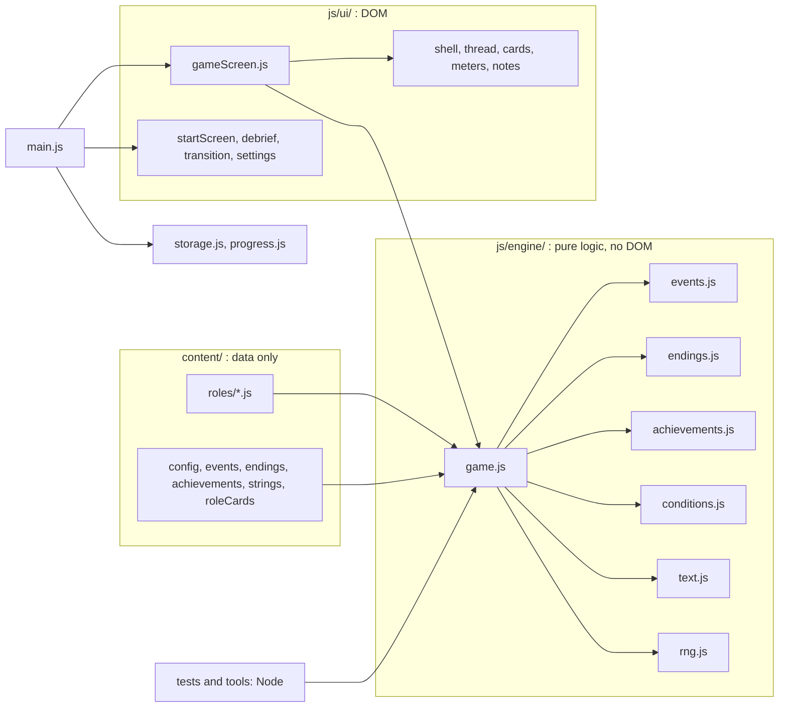
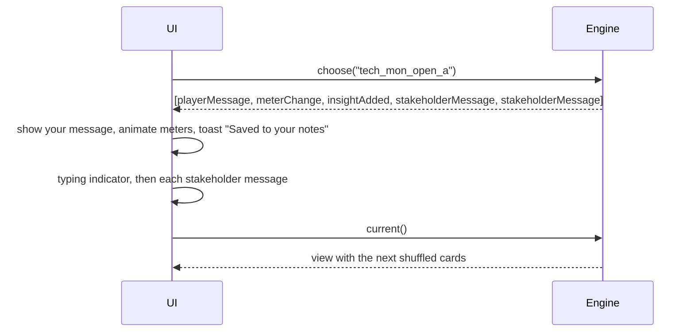
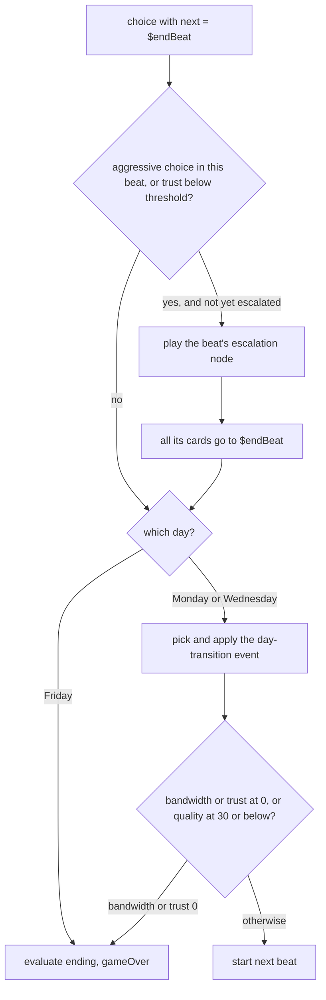

# Architecture

Pushback Quest is a static site: vanilla HTML, CSS and JavaScript (ES modules), no framework, no bundler, no build step and no runtime dependencies. This document explains how the pieces fit together.

## Layers



- **`content/`** holds all text and numbers: role scripts, difficulty settings, the event pool, endings, achievements and UI strings. Nothing in it runs code. Keeping every string here keeps localization possible.
- **`js/engine/`** is pure JavaScript with no access to the DOM. It runs in the browser, in the unit tests and in the simulator, so game rules are tested the same way they run.
- **`js/ui/`** renders. It reads the engine's views and plays the engine's effects. It never mutates game state.
- **`js/main.js`** switches between the start screen, the game and the debrief, loads a role with a dynamic `import()` only after it is chosen, and saves finished runs.
- **`js/storage.js`** wraps `localStorage` in `try/catch` with an in-memory fallback, so the game works when storage is blocked.

## The engine API

```js
const game = createGame({ role, difficulty, name, seed });
game.current();      // the view to render
game.choose(id);     // applies a choice, returns an ordered list of effects
game.log();          // decision history, for the debrief
game.snapshot();     // a copy of the state, for the debrief, tests and the simulator
```

`role` is the role content object (see `content/roles/*.js`). The caller loads it; `content/roles/index.js` exports `loadRole(id)` for that.

### The effect list pattern

`choose()` does not just return a new state. It returns the *story of what happened*, in order, and the UI plays it with delays:



| Effect | Meaning | Key fields |
|---|---|---|
| `playerMessage` | The response the player "sent" | `text`, `chat`, `tag` |
| `meterChange` | Meters changed | `deltas` (applied, after difficulty scaling), `meters` (new values), `source` (`choice`, `event`, `criticalIncident`) |
| `insightAdded` | A note was earned | `id`, `title`, `note` |
| `systemLine` | A centred system message | `text` |
| `participantJoined` | A manager joined the thread | `id`, `name`, `title`, `chat` |
| `stakeholderMessage` | A message from someone else | `from`, `fromName`, `chat`, `time`, `text` |
| `dayTransition` | A new day starts | `from`, `to`, `event` (the event, with its applied impact, or `null`) |
| `criticalIncident` | Quality fell to 30 or below (once per run) | `label`, `text` |
| `triage` | Wednesday competing message | `preview` (chat, sender, text), `prompt` |
| `achievementUnlocked` | A run achievement became true | `id` |
| `gameOver` | The week ended | `ending` (id, title, description, lesson) |

`gameOver` is always the last effect. The text in effects and views is plain text with tokens resolved; the UI inserts it with `textContent` only.

### The view

`current()` returns what to draw now:

```js
{
  ended: false,
  kind: "choice" | "triage",
  nodeId, day, time, chat, boundary,
  messages: [{ from, fromName, chat, time, text }],  // empty when already delivered
  preview, prompt,                                    // triage only
  cards: [{ id, text, usesInsight? }],                // already shuffled; no impacts or coaching
  meters, notes
}
```

When the week has ended it returns `{ ended: true, ending, meters, notes }`. Impacts and coaching are never sent to the UI.

## State shape

```js
{
  roleId, difficulty, name, seed,
  meters: { trust, bandwidth, quality },
  startMeters, minMeters,            // minMeters: lowest value reached, used by endings
  day: "mon" | "wed" | "fri",
  beat: { id, nodeId, tagsChosen: [], escalated: false, delivered: [], returnTo: null },
  overcommit: 0,                     // +1 per passive choice
  insights: [],                      // insight ids
  flags: { criticalIncident: false },
  outcomes: { mon: null },           // last tag of Monday's beat
  firedEvents: [],
  history: [{ nodeId, choiceId, tag, subtype, impact, appliedImpact, day, escalation, boundary, usedInsight }],
  completed: false,                  // Friday's beat finished
  achievements: [],                  // ids already announced this run
  ended: null                        // ending id
}
```

`beat.delivered` records which nodes' messages were already shown, so returning to a node (after a triage detour) does not repeat them. `beat.returnTo` is where a Monday follow-up returns to.

## Content: roles, nodes and choices

A role file exports one object (see [CONTENT-GUIDE.md](CONTENT-GUIDE.md) for the full schema and authoring rules):

```js
{
  id, title, qualityMeaning, teaser,
  stakeholders: { id: { name, title, presence } },
  insights:     { id: { title, note } },
  beats: {
    mon: { start, escalation },
    wed: { start, escalation, mondayFollowUp: { passive, assertive, aggressive } },
    fri: { start, escalation }
  },
  criticalIncident: { text },
  tips: { passive, aggressive, assertive },
  nodes: { <nodeId>: node }
}
```

A node:

```js
{
  id, type: "choice", day, time, chat,            // chat = whose thread it happens in
  joins?: "<stakeholder id>",                     // escalation nodes: a manager is added
  boundary?: true,                                // non-negotiable moment
  messages: [{ from, text, variants?: [{ when, text }] }],
  choices: [{
    id, tag: "passive" | "aggressive" | "assertive",
    subtype?: "clarify" | "tradeoff" | "impact" | "boundary" | "insight" | "holding" | "repair",
    text, impact: { trust, bandwidth, quality },
    next,                                         // a node id or a special value
    grantsInsight?, requiresInsight?,
    coaching, betterResponse?                     // betterResponse on passive and aggressive cards
  }]
}
```

Every node has exactly one passive, one aggressive and one assertive base card. Insight cards (`requiresInsight`) are extras on Friday's opening node and appear only when the matching note was earned (at most two).

### Special `next` values

- **`$endBeat`** ends the current beat. The engine then checks escalation: if the player made any aggressive choice in the beat, or Trust is below the difficulty's threshold, the beat's escalation node plays (at most once per beat). Otherwise it moves to the day transition, or ends the week after Friday.
- **`$return`** is used only by the Monday follow-up nodes during Wednesday's triage. It returns to the Wednesday flow.



### Wednesday triage

When Wednesday starts, the engine delivers the Wednesday stakeholder's opening messages, then instead of the node's cards it offers three triage cards, built from `content/strings.js`:

1. Answer the Wednesday stakeholder first. The Monday stakeholder waits (the difficulty's waiting penalty applies).
2. Answer the Monday stakeholder first. The Wednesday stakeholder waits (same penalty) and the Monday follow-up node plays, then returns with `$return`.
3. Send a holding message to the Monday stakeholder. No trust penalty, Bandwidth −3, subtype `holding`.

Which Monday follow-up plays depends on `outcomes.mon` (the last tag of Monday's beat). The preview text is that follow-up node's first message.

## Conditions and variants

A `when` object is a set of optional keys combined with AND: `trustLt`, `trustGte`, `bandwidthLt`, `bandwidthGte`, `qualityLt`, `qualityGte`, `overcommitGte`, `overcommitEq`, `hasInsight`, `flag`, `mondayOutcome`, `beatHadTag`, `difficulty`. Message `variants` are tried in order; the first match wins, otherwise the default `text` is used. An unknown key throws, so a typo in content fails loudly. The same `when` objects gate random events.

Text tokens: `{name}` and `{name|fallback}` (the player's sanitized first name), `{role}`, and the engine-supplied `{mon}`, `{wed}` and `{who}`. The name is limited to 24 characters and to letters, spaces, hyphens and apostrophes.

## Meters, difficulty, failure and endings

- Meters are clamped to 0 to 100 after every change. A status word follows the value: Healthy (60 or above), Strained (31 to 59) or Critical (30 or below).
- Negative changes are multiplied by the difficulty (0.75, 1.0 or 1.25) and rounded to the nearest integer, symmetrically around zero. This applies to choices, events and the critical incident.
- After every change the engine checks: Bandwidth at 0 ends the week (Burnout); Trust at 0 ends it (The Wall); Quality at 30 or below fires a one-time critical incident (Trust −10).
- Endings are evaluated in order, and the first match wins: Burnout, The Wall, Master Negotiator, Quiet Fixer, Steady Professional, Running on Fumes (`js/engine/endings.js`).

### Events

At each day transition one event fires, chosen in `js/engine/events.js`. At Wednesday to Friday, a delayed consequence replaces the random event when the player over-committed (`overcommit` of 3 or more, then 2), and the guaranteed "Rested and ready" event fires at 0. Otherwise the random pool is filtered by condition and by events already fired, weighted by polarity and difficulty, and drawn with the seeded generator. Random event impacts are capped at 10 per meter.

## Seeded randomness

`js/engine/rng.js` has a small mulberry32 generator and a Fisher-Yates shuffle. The seed comes from the current time (five digits) or from `?seed=<number>` in the URL, and it is shown in the debrief. Cards are shuffled each time a node is entered, and events are drawn from the same generator. Because the sequence of calls is a pure function of the choices made, the same seed and the same choices always produce the same run. The view is built once when a node is entered, so calling `current()` repeatedly never reshuffles.

## Persistence and privacy

`localStorage` key `pushbackQuest.v1` stores `{ achievements, endingsSeen, rolesCompleted, settings: { theme, reducedMotion } }`. A run in progress is never saved. `js/progress.js` records a finished run and returns the achievements it earned. Nothing is sent off the device.

## Quality tools

All three run in Node against the same engine.

| Tool | Purpose |
|---|---|
| `tools/lint-content.mjs` | Schema, reachability, one-of-each-tag, impact ranges per tag, insight use, boundary rules, length limits, unknown tokens and a banned real-brand list. Exits with an error on any problem. |
| `tools/simulate.mjs` | For each role and difficulty, enumerates every choice path (depth-first) across seeds and reports the ending distribution, unreachable endings and nodes, meter ranges and decision counts. It also runs three fixed policies (best assertive, always passive, always aggressive) and checks the balance targets for the Standard week. |
| `tests/` (`node --test`) | Unit tests for the engine, content, achievements, linter and simulator, plus guards for contrast, size, security and page structure. |

### Balance targets (Standard week)

- Every ending and every node is reachable in every role.
- Always choosing the best assertive card (insight cards when available) reaches Master Negotiator on at least 90% of seeds.
- Always passive never reaches Master Negotiator. Always aggressive reaches The Wall.
- A typical run has 7 to 11 decisions.

## Security

A Content-Security-Policy meta tag restricts scripts to the page's own origin and styles and fonts to Google Fonts. There are no inline scripts or handlers. All dynamic text is inserted with `textContent` or created elements; the small DOM helper in `js/ui/dom.js` never uses `innerHTML`, and a test scans the code to keep it that way. Element styles are set through the CSS object model (`el.style`), which the policy allows.

## Deployment

`.github/workflows/ci.yml` runs the content lint and the unit tests, then one simulator job per role. `.github/workflows/pages.yml` stages the runtime files and publishes them with GitHub's official Pages actions. All paths in the site are relative, so it works from a project subpath.
